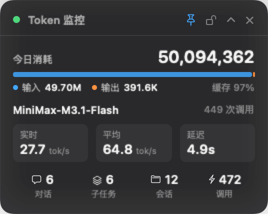
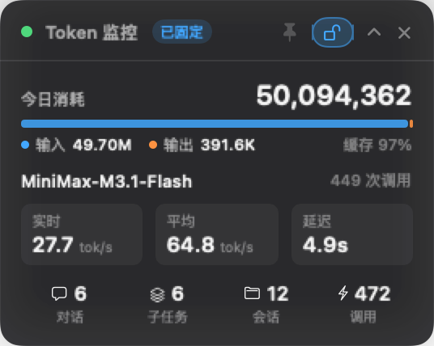

# TokenHUD — WorkBuddy Token 悬浮监控窗

原生 macOS 置顶浮窗，实时展示今日 token 消耗、当前模型速度、平均速度与对话次数。
夜间暗色主题、半透明毛玻璃背景，支持「固定」——固定后窗口对鼠标完全穿透，只有点「释放」才能再次交互。



固定态（释放按钮高亮描边，为唯一可点入口）：



## 安装与运行

```bash
./build.sh                 # 编译并打包为 dist/TokenHUD.app
open dist/TokenHUD.app     # 启动
```

浮窗出现在主屏右上角，按住标题栏可拖动，位置会被记住。

## 外观

| 项目 | 取值 |
|---|---|
| 主题 | 暗色系（`NSAppearance.darkAqua`），**强制生效**，不随系统浅色/深色切换 |
| 背景 | 深色（RGB 0.035 / 0.042 / 0.058）+ 58% 不透明度 |
| 毛玻璃 | `.ultraThinMaterial` 叠加（55% 不透明度），透出下层内容 |
| 强调色 | 青蓝 `RGB(0.31, 0.72, 1.00)`；输出量用暖橙；正向指标用绿 |
| 描边 | 白色 13% 不透明度，0.5pt |
| 投影 | 黑色 42% 不透明度，半径 16，垂直偏移 5 |

## 固定 / 释放机制

标题栏右侧有两个按钮（📌 图钉 / 🔓 开锁）：

- **📌 固定** —— 主浮窗设置 `ignoresMouseEvents = true`，
  窗口服务器不再把该区域的鼠标事件路由给浮窗，事件**直接穿透到下层应用**。
  浮窗仍正常显示与刷新，只是不再拦截任何鼠标操作。
  固定后标题栏出现「已固定」标签，释放按钮带高亮描边。
- **🔓 释放** —— 恢复鼠标交互。这是固定状态下**唯一**可点的入口。

### 实现要点：为什么用「双窗口」而不是 hitTest

常见做法是覆写 `NSView.hitTest` 在穿透区域返回 `nil`。**这行不通**：
窗口服务器已经把该屏幕区域判给了浮窗，`hitTest` 返回 `nil` 只是让窗口不处理事件，
事件仍被窗口级路由吞掉，**不会传递给下层应用**。

正确的做法是：

1. 主浮窗 `ignoresMouseEvents = true` —— 窗口服务器层面真正让路；
2. 另开一个**透明热区小窗**（`HUDHotspotPanel`），叠在「释放」按钮正上方，
   层级比主窗高 1，自身不忽略鼠标事件，点击即解除固定。

热区定位链路（`HUDPanel.repositionHotspot()`）：

```
SwiftUI 按钮矩形（根坐标系，top-left 原点）
  → host.convert(rect, to: nil)   // 窗口基坐标（bottom-left 原点）
  → 加窗口 frame.origin            // 屏幕坐标
  → 外扩 8pt 作为热区
```

`NSHostingView.isFlipped == true`，所以 SwiftUI 根坐标系与 host 自身坐标系原点一致，
可以直接转换；`host.convert(rect, to: nil)` 已完成 Y 轴翻转。

热区会跟随：主窗移动（`setFrame` 覆写）、主窗层级变化、折叠/展开（按钮位置变化）、
主窗隐藏时同步隐藏（避免留下悬空的可点区域）。

## 菜单栏（右上角仪表盘图标）

| 菜单项 | 作用 | 快捷键 |
|---|---|---|
| 显示 / 隐藏浮窗 | 切换浮窗可见性 | ⌘H |
| 折叠为一行 | 紧凑 / 展开切换 | ⌘C |
| 固定（鼠标穿透） | 切换固定状态 | ⌘P |
| 立即刷新 | 强制重新采集 | ⌘R |
| 始终置顶 | 在置顶与普通层级间切换 | — |
| 开机自动启动 | 写入 LaunchAgent 实现登录自启 | — |
| 退出 | 退出应用 | ⌘Q |

## 展示指标

| 指标 | 口径 |
|---|---|
| 今日消耗 | 输入 token + 输出 token |
| 输入 / 输出 | 分别取 `providerData.usage` 的 `inputTokens` / `outputTokens` |
| 缓存命中 | `inputTokensDetails[].cached_tokens` 占输入的比例 |
| 当前模型 | 今日调用次数最多的模型（`requestModelName`） |
| 实时速度 | 最近一次生成的输出速度（tok/s） |
| 平均速度 | 今日加权平均输出速度 = 总输出 token / 总生成耗时 |
| 延迟 | 最近一次 LLM 调用的响应耗时 |
| 对话 | 顶层会话中真实的用户提问次数 |
| 子任务 | 子代理（subagents）任务数 |
| 会话 | 今日活跃的会话数 |
| 调用 | 今日 LLM 调用总次数 |

## 数据来源与实现要点

**数据源**：`~/.workbuddy/projects/**/<sessionId>.jsonl`（含 `subagents/` 子目录）

- **token 用量**：每条 `function_call` 事件的 `providerData.usage`
- **模型名**：`providerData.requestModelName`
- **生成耗时**：以「上一轮 `function_call_result` 时间戳 → 本轮 usage 时间戳」推导
  —— 已与 `~/.workbuddy/traces` 中权威的 `generation` span 交叉校验，**中位误差 49ms**
- **对话次数**：只统计真实用户提问。系统注入（`<system-reminder>` / `<identity_context>` 等）
  已排除；主会话的提问包在 `<user_query>` 标签内，需按标签提取而非整条前缀判断

### 两个关键实现细节

1. **残行处理**：日志是追加写的，读到的末段可能是写了一半的记录。
   以 `\n` 切分后，末段若能解析成 JSON 即为完整记录（采用），否则缓存起来等下次追加再拼接。
   不能无条件丢弃末段 —— 日志末尾常不以换行结尾，无条件丢弃会漏掉最后一条完整记录。

2. **大文件回溯**：个别会话日志可达数百 MB。首次读取时从文件尾部向前分块回溯，
   定位「今天之前」的最后一条记录，直接从今日内容的起点开始读，避免全量扫描。

**增量读取**：每个文件维护读位点（offset）与残行缓存，只解析新增字节。
跨天自动重置；文件被截断重写时同样重置。

## 源码结构

| 文件 | 职责 |
|---|---|
| `Sources/TokenHUD/UsageStore.swift` | 数据层：扫描会话日志、增量解析、指标聚合 |
| `Sources/TokenHUD/HUDView.swift` | 暗色主题配色、布局常量、展开/折叠两套视图 |
| `Sources/TokenHUD/HUDPanel.swift` | 主浮窗 + 固定/热区双窗机制 |
| `Sources/TokenHUD/TokenHUDApp.swift` | 应用入口、数据模型、菜单栏、开机自启 |
| `Sources/TokenHUD/Renderer.swift` | 离屏渲染预览图（`--render`） |

`build.sh` 会自动编译 `Sources/TokenHUD/` 下的全部 `.swift` 文件，新增文件无需手工维护清单。

## 验证

```bash
# 数据层自检（今日汇总）
mkdir -p .check && cat > .check/selftest.swift <<'SWIFT'
import Foundation
let store = UsageStore()
let s = store.collect()
print("day=\(s.day) sessions=\(s.sessionCount) calls=\(s.llmCalls)")
print("total=\(s.totalTokens) input=\(s.input) output=\(s.output) cached=\(s.cached)")
print("turns=\(s.userTurns) (top=\(s.topLevelTurns) sub=\(s.subagentTasks)) model=\(s.currentModel)")
print("lastSpeed=\(s.lastSpeed ?? -1) avgSpeed=\(s.avgSpeed ?? -1) latency=\(s.lastLatencySec ?? -1)")
SWIFT
swiftc -O -o .check/selftestbin Sources/TokenHUD/UsageStore.swift .check/selftest.swift && ./.check/selftestbin

# 增量一致性（连续采集不重复累加）
mkdir -p .check && cat > .check/main.swift <<'SWIFT'
import Foundation
let store = UsageStore()
func line(_ s: UsageSnapshot) -> String {
    String(format: "calls=%d total=%d turns=%d gens=%d",
           s.llmCalls, s.totalTokens, s.userTurns, s.generations.count)
}
for i in 1...3 { print("第 \(i) 次:", line(store.collect())) }
SWIFT
swiftc -O -o .check/incbin Sources/TokenHUD/UsageStore.swift .check/main.swift && ./.check/incbin

# 独立实现的交叉对账（不复用 Swift 逻辑）
python3 crosscheck.py

# 固定/释放运行时链路验证（9 项断言）
mkdir -p .check && cat > .check/runtime.swift <<'SWIFT'
import AppKit
import SwiftUI
// 断言：SwiftUI 上报按钮位置 -> 热区窗定位 -> 固定/释放状态同步
// 详见本文件末尾的 check(...) 调用
SWIFT
swiftc -O -o .check/rtbin Sources/TokenHUD/UsageStore.swift Sources/TokenHUD/HUDView.swift \
  Sources/TokenHUD/HUDPanel.swift .check/runtime.swift -framework AppKit -framework SwiftUI && ./.check/rtbin
```

`crosscheck.py` 用完全独立的代码路径按相同口径验算，两边结果一致。

## 渲染预览

```bash
swiftc -O -parse-as-library -o /tmp/hudrender Sources/TokenHUD/*.swift -framework AppKit -framework SwiftUI
/tmp/hudrender --render out.png               # 展开态
/tmp/hudrender --render out.png --compact     # 折叠态
/tmp/hudrender --render out.png --pinned      # 固定态
```

## 备注

- 浮窗位置会被记住；启动时若记录的位置已完全落到所有屏幕之外
  （换屏、拔显示器、改分辨率后会出现），会自动拉回主屏右上角，
  避免"浮窗消失且再也点不到"。
- 浮窗为 `LSUIElement`（无 Dock 图标），以 `NSWindow.Level.floating` 层级显示，
  层级 3 > 普通应用窗口层级 0，因此始终浮在 WorkBuddy 窗口之上。
- 固定时热区窗层级为 `floating + 1`，保证不被主窗遮挡。
- 数据每 2 秒刷新一次，采集在后台队列执行，不阻塞界面。
- 若 WorkBuddy 调整了会话日志格式，解析器可能需要同步更新（集中在 `UsageStore.swift`）。
